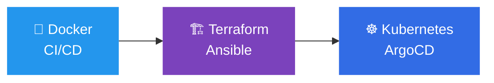

---

## 👋 Sobre mim

Sou **Analista Sênior de TI** com mais de **18 anos** mantendo ambientes corporativos estáveis, seguros e automatizados. Minha base é **infraestrutura Windows/Active Directory** e **segurança de rede (Fortinet, Mikrotik)**, e hoje levo essa experiência para a cultura **DevOps**: infraestrutura como código, pipelines e containers.

- 🛡️ Segurança e conformidade **LGPD** em ambientes de produção
- ⚙️ Automação de rotinas de TI com **PowerShell** e **Python**
- ☁️ Cloud com **Microsoft Azure**
- 🎓 Pós-graduação em **DevOps**
- 🚀 Construindo um portfólio público: **Docker → CI/CD → Terraform/Ansible → Kubernetes**

---

## 🧰 Stack

**Infraestrutura & Segurança**

**Automação & Desenvolvimento**

**DevOps (em evolução)**

---

## 📌 Projetos em destaque

| Projeto | O que resolve | Tecnologias |
|---|---|---|
| 🛡️ [**Guia PowerShell para Active Directory**](https://github.com/eduardogrigorio/Gerenciamento-de-Contas-Active-Directory---PowerShell-Guide) | Comandos curtos para usuários, endpoints, servidores, auditoria e ações em massa |   |
| 🧰 [**Play-Script-PowerShell**](https://github.com/eduardogrigorio/Play-Script-PowerShell) | Scripts operacionais para o dia a dia do TI |   |
| 🔧 [**Kit de Ferramentas para Suporte**](https://github.com/eduardogrigorio/Kit-de-Ferramentas-para-Suporte) | Ferramentas para agilizar atendimento e suporte |  |
| 🌐 [**habilidades.com.br**](https://github.com/eduardogrigorio/habilidades.com.br) | Página profissional com habilidades e experiência |  |

---

## 🗺️ Roadmap DevOps

- [x] Base sólida: Windows Server, Active Directory, redes e segurança
- [x] Automação com PowerShell e Python
- [x] Pós-graduação em DevOps
- [ ] 🐳 Projeto Docker com pipeline CI/CD (GitHub Actions)
- [ ] 🏗️ Infraestrutura como código com Terraform e Ansible
- [ ] ☸️ Deploy em Kubernetes com GitOps (ArgoCD)

---

## 📊 GitHub

---

## 🤝 Vamos conversar?

Aberto a conversas sobre **infraestrutura, segurança, automação e oportunidades em DevOps**.

