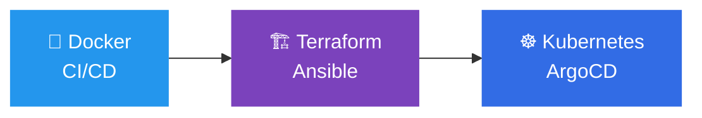
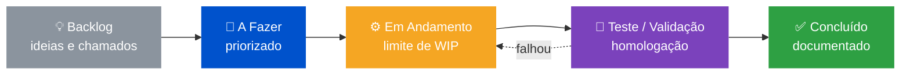
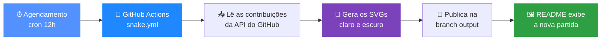

---

## 👋 Sobre mim

Sou **Analista Sênior de TI** com mais de **18 anos** mantendo ambientes corporativos estáveis, seguros e automatizados. Minha base é **infraestrutura Windows/Active Directory** e **segurança de rede (Fortinet, Mikrotik)**, e hoje levo essa experiência para a cultura **DevOps**: infraestrutura como código, pipelines e containers.

- 🛡️ Segurança e conformidade **LGPD** em ambientes de produção
- ⚙️ Automação de rotinas de TI com **PowerShell** e **Python**
- 📡 Monitoramento e observabilidade com **Zabbix** e **Grafana**
- 🗂️ Gestão de ativos e chamados com **GLPI**
- 🖥️ Acesso remoto e gerenciamento de endpoints com **MeshCentral**
- 📋 Gestão de projetos com **Trello** (Kanban), apoiada por **Microsoft To Do** e **Google Keep**
- 🐍 Automação e APIs com **Python** (FastAPI)
- ☁️ Cloud com **Microsoft Azure**
- 🎓 Pós-graduação em **DevOps**
- 🚀 Construindo um portfólio público: **Docker → CI/CD → Terraform/Ansible → Kubernetes**

---

## 🧰 Stack

**Infraestrutura & Segurança**

**Automação & Desenvolvimento**

**Monitoramento, Gestão & Acesso Remoto**

**Gestão de Projetos & Produtividade**

**DevOps (em evolução)**

---

## 📌 Projetos em destaque

| Projeto | O que resolve | Tecnologias |
|---|---|---|
| 🛡️ [**Guia PowerShell para Active Directory**](https://github.com/eduardogrigorio/Gerenciamento-de-Contas-Active-Directory---PowerShell-Guide) | Comandos curtos para usuários, endpoints, servidores, auditoria e ações em massa |   |
| 🧰 [**Play-Script-PowerShell**](https://github.com/eduardogrigorio/Play-Script-PowerShell) | Scripts operacionais para o dia a dia do TI |   |
| 🔧 [**Kit de Ferramentas para Suporte**](https://github.com/eduardogrigorio/Kit-de-Ferramentas-para-Suporte) | Ferramentas para agilizar atendimento e suporte |  |
| 🌐 [**habilidades.com.br**](https://github.com/eduardogrigorio/habilidades.com.br) | Página profissional com habilidades e experiência |  |

---

## 🗺️ Roadmap DevOps

- [x] Base sólida: Windows Server, Active Directory, redes e segurança
- [x] Automação com PowerShell e Python
- [x] Pós-graduação em DevOps
- [ ] 🐳 Projeto Docker com pipeline CI/CD (GitHub Actions)
- [ ] 🏗️ Infraestrutura como código com Terraform e Ansible
- [ ] ☸️ Deploy em Kubernetes com GitOps (ArgoCD)

---

## 📋 Gestão de Projetos: Kanban Mode

> Infraestrutura sem organização vira incêndio. Aqui o **backlog também é código**: tudo visível, priorizado e versionado na cabeça. 🧠

### 🎮 Meu fluxo de missões

### 🕹️ Minha build de ferramentas

| Ferramenta | Para que uso | Nível de uso |
|------------|--------------|--------------|
|  **Trello** ⭐ *main* | Quadros Kanban de projetos, checklists, prazos e etiquetas por prioridade | `██████████` **MAX** |
|  **Microsoft To Do** | Tarefas pessoais do dia e lembretes integrados ao ecossistema Microsoft | `███████░░░` Alto |
|  **Google Keep** | Anotações rápidas, ideias e comandos que quero lembrar | `██████░░░░` Médio |
|  **GitHub** | Versionamento, issues e documentação técnica dos projetos | `███████░░░` Alto |

### ⚔️ Regras da minha guilda

- 🎯 **Um quadro por projeto**, com colunas claras e um dono para cada cartão
- 🚦 **Limite de itens em andamento** (WIP): terminar vale mais do que começar
- 🏷️ **Etiquetas por cor:** 🔴 urgente · 🟠 importante · 🟢 melhoria · 🔵 estudo
- ✅ **Checklist em todo cartão**, igual a um plano de rollback
- 📝 **Cartão concluído = documentado.** Se não está documentado, não terminou
- 🔁 **Revisão semanal** do backlog, para o quadro não virar cemitério de ideias

> 💡 **Easter egg:** Kanban é a base de DevOps. Fluxo contínuo, visibilidade e melhoria constante são os mesmos princípios de um pipeline CI/CD. É por isso que um bom quadro e um bom pipeline andam juntos. 🚀

---

## 📊 GitHub

---

## 🎮 Fase Bônus: Quiz Nerd de TI

> Responda de cabeça e clique para ver a resposta. Anote seus acertos e confira sua patente no final. 👇

<b>🔓 Fase 1:</b> Qual cmdlet desbloqueia uma conta bloqueada no Active Directory?

 

**✅ `Unlock-ADAccount -Identity usuario`**

Dica de ouro: para descobrir *quem* bloqueou, procure o evento **4740** no PDC Emulator.

<b>📜 Fase 2:</b> Qual ID de evento do Windows registra o bloqueio de uma conta?

 

**✅ 4740**

Ele mostra o usuário e a máquina de origem do bloqueio. Já o **4625** registra cada falha de logon.

<b>👑 Fase 3:</b> Qual função FSMO recebe os bloqueios de conta e é a referência de tempo do domínio?

 

**✅ PDC Emulator**

Confira com `Get-ADDomain | Select PDCEmulator`.

<b>🔌 Fase 4:</b> Qual porta padrão o LDAP usa (sem criptografia)?

 

**✅ 389** (e **636** para LDAPS)

Teste com `Test-NetConnection srv-dc01 -Port 389`.

<b>📡 Fase 5:</b> Qual porta o Zabbix Agent escuta por padrão?

 

**✅ 10050**

O Zabbix Server recebe dados na porta **10051**.

<b>🏗️ Fase Final:</b> O que significa IaC em DevOps?

 

**✅ Infrastructure as Code (Infraestrutura como Código)**

Definir servidores e redes em arquivos versionados (Terraform, Ansible), em vez de cliques manuais.

 

### 🏆 Sua patente

| Acertos | Patente |
|:-------:|---------|
| 6 / 6 | 🧙‍♂️ **Mestre do Domain Admin** |
| 4 – 5 | 🛡️ **Sysadmin Sênior** |
| 2 – 3 | 🔧 **Analista em Evolução** |
| 0 – 1 | 🐣 **Estagiário do Help Desk** (bora estudar!) |

---

## 🐍 Snake Mode: o jogo das contribuições

> Um jogo que se joga sozinho, com **regras claras**, **pipeline automatizado** e **placar** que depende do meu ritmo de commits.

<picture>
  <source media="(prefers-color-scheme: dark)" srcset="https://raw.githubusercontent.com/eduardogrigorio/eduardogrigorio/output/github-contribution-grid-snake-dark.svg" />
  <source media="(prefers-color-scheme: light)" srcset="https://raw.githubusercontent.com/eduardogrigorio/eduardogrigorio/output/github-contribution-grid-snake.svg" />
  
</picture>

### 📋 Regras do jogo

| # | Elemento | Como funciona |
|:-:|----------|---------------|
| 1 | 🟩 **Tabuleiro** | O gráfico de contribuições dos últimos 12 meses |
| 2 | 🍎 **Comida** | Cada quadrado verde é um dia com commit, issue ou PR |
| 3 | 🐍 **Cobra** | Percorre o tabuleiro seguindo o caminho mais eficiente |
| 4 | 🏆 **Placar** | Mais commits = mais comida = animação mais longa |
| 5 | 🔁 **Rodada** | Uma nova partida é gerada automaticamente a cada 12 horas |

### ⚙️ Pipeline (DevOps na prática)

### 🎯 Metas da temporada

- [x] Pipeline de geração automática com GitHub Actions
- [x] Tema claro e escuro
- [ ] 🔥 Commits em **pelo menos 4 dias por semana**
- [ ] 📦 Publicar os **3 projetos DevOps** do roadmap (Docker, Terraform/Ansible, Kubernetes)
- [ ] 🧪 Adicionar badge de **CI** (PSScriptAnalyzer) nos repositórios de scripts

> 💡 **Curiosidade:** este jogo é um mini caso de **CI/CD**: agendamento, execução automatizada, artefato versionado e entrega contínua. É a mesma lógica que uso para infraestrutura.

---

## 🤝 Vamos conversar?

Aberto a conversas sobre **infraestrutura, segurança, automação e oportunidades em DevOps**.

